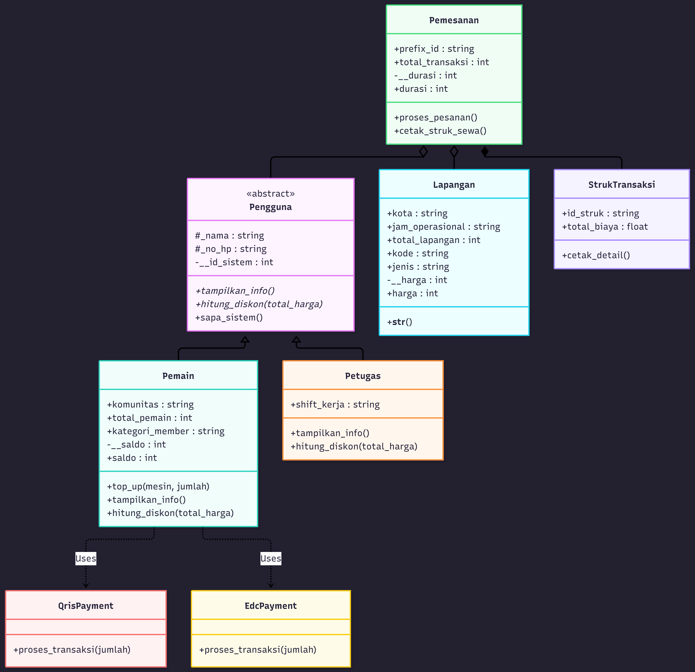

# Sistem Pemesanan Lapangan Bulutangkis Samarinda

Program ini merupakan sistem sederhana untuk mengelola pemesanan lapangan bulutangkis di Samarinda. Sistem dibuat menggunakan bahasa pemrograman **Python** dan menerapkan konsep *Object-Oriented Programming* (OOP) lanjutan, seperti *Inheritance*, Abstraksi, Polimorfisme, Enkapsulasi, serta relasi UML berupa Asosiasi, Agregasi, dan Komposisi.

---

## 1. Penjelasan Program

Program ini dirancang untuk menyimulasikan proses pendataan pemain, petugas GOR, informasi lapangan, metode pembayaran, serta transaksi pemesanan lapangan bulutangkis.

Fitur utama yang terdapat pada program meliputi:

1. Pendataan pengguna sistem, yaitu pemain dan petugas.
2. Penerapan pewarisan antara class `Pengguna`, `Pemain`, dan `Petugas`.
3. Penerapan abstraksi menggunakan `Abstract Base Class` atau `ABC`.
4. Penerapan polimorfisme melalui *method overriding*, *duck typing*, dan *operator overloading*.
5. Pengelolaan informasi lapangan bulutangkis.
6. Proses top-up saldo menggunakan metode pembayaran QRIS atau EDC.
7. Proses pemesanan lapangan dan perhitungan diskon.
8. Pembuatan struk transaksi secara otomatis setelah pesanan berhasil diproses.

---

## 2. UML Class Diagram

Berikut merupakan diagram kelas dari sistem pemesanan lapangan bulutangkis:



Diagram di atas menggambarkan struktur class serta hubungan antarclass pada program. Sistem terdiri dari class utama `Pengguna`, `Pemain`, `Petugas`, `Lapangan`, `Pemesanan`, `StrukTransaksi`, `QrisPayment`, dan `EdcPayment`.

---

## 3. Penjelasan Diagram Kelas

### A. Class Abstrak `Pengguna`

Class `Pengguna` merupakan superclass abstrak yang mewarisi `ABC` (*Abstract Base Class*). Class ini berfungsi sebagai dasar atau *blueprint* bagi seluruh jenis pengguna di dalam sistem.

Atribut pada class `Pengguna`:

- `_nama: string` — nama pengguna (protected).
- `_no_hp: string` — nomor telepon pengguna (protected).
- `__id_sistem` — ID unik pengguna dalam sistem, diisi otomatis menggunakan fungsi bawaan Python `id(self)`.

Method pada class ini:

- `tampilkan_info()` — abstract method, wajib diimplementasikan oleh subclass.
- `hitung_diskon(total_harga)` — abstract method, wajib diimplementasikan oleh subclass.
- `sapa_sistem()` — concrete method yang dapat langsung digunakan oleh seluruh turunannya tanpa perlu ditulis ulang.

Karena merupakan class abstrak, `Pengguna` **tidak dapat dibuat objeknya secara langsung**. Python akan memunculkan `TypeError` apabila class ini diinstansiasi tanpa mengimplementasikan seluruh method abstraknya.

---

### B. Class `Pemain`

Class `Pemain` merupakan subclass atau turunan dari class `Pengguna`. Class ini digunakan untuk merepresentasikan pelanggan atau penyewa lapangan.

Atribut pada class `Pemain`:

- `komunitas: string` — **class attribute** bernilai tetap (`"PB Samarinda"`), dimiliki bersama oleh seluruh objek Pemain.
- `total_pemain: int` — **class attribute** yang berfungsi sebagai counter otomatis, bertambah setiap kali objek `Pemain` baru dibuat.
- `kategori_member: string` — atribut instance untuk menentukan jenis keanggotaan (misalnya `"VIP"` atau kategori lainnya).
- `__saldo: int` — atribut private, diakses melalui `@property` dan `@saldo.setter` agar nilainya tidak dapat diisi angka negatif.

Method yang dimiliki:

- `tampilkan_info()` — menampilkan kategori member, nama, nomor HP, dan saldo saat ini.
- `hitung_diskon(total_harga)` — mengembalikan diskon sebesar 10% jika `kategori_member` bernilai `"VIP"`, dan 0% untuk kategori lainnya.
- `top_up(mesin, jumlah)` — menambahkan saldo pemain dengan terlebih dahulu memanggil fungsi `jalankan_pembayaran()` untuk memproses transaksi melalui objek pembayaran yang diberikan.

---

### C. Class `Petugas`

Class `Petugas` merupakan subclass dari `Pengguna`. Class ini digunakan untuk merepresentasikan petugas atau karyawan GOR.

Atribut tambahan pada class `Petugas`:

- `shift_kerja: string` — menyimpan informasi jadwal shift kerja petugas.

Method yang diimplementasikan:

- `tampilkan_info()` — menampilkan nama, nomor HP, dan shift kerja petugas.
- `hitung_diskon(total_harga)` — mengembalikan diskon tetap sebesar 50% dari total harga.

---

### D. Class `Lapangan`

Class `Lapangan` digunakan untuk menyimpan informasi mengenai lapangan bulutangkis yang dapat disewa.

Atribut pada class ini:

- `kota: string` — **class attribute** bernilai tetap `"Samarinda"`, dimiliki bersama oleh seluruh objek Lapangan.
- `jam_operasional: string` — **class attribute** bernilai tetap `"08:00 - 23:00"`.
- `total_lapangan: int` — **class attribute** sebagai counter otomatis, bertambah setiap kali objek `Lapangan` baru dibuat.
- `kode: string` — atribut instance, kode unik tiap lapangan (misalnya `"L01"`).
- `jenis: string` — atribut instance, jenis permukaan lapangan (misalnya `"Karpet Vinyl"`).
- `__harga: int` — atribut private, diakses melalui `@property` dan `@harga.setter` dengan validasi agar nilainya tidak boleh negatif.

Class ini memiliki method `__str__()` sebagai penerapan **operator overloading**, sehingga objek dapat langsung ditampilkan menggunakan `print()` dalam format yang lebih informatif.

Contoh hasil tampilan:

```text
[L01] Lapangan Karpet Vinyl - Harga: Rp50,000/jam
```

---

### E. Class `Pemesanan`

Class `Pemesanan` merupakan class utama yang menangani proses pemesanan lapangan.

Atribut pada class ini:

- `prefix_id: string` — **class attribute** bernilai tetap `"TRX"`, digunakan sebagai awalan penomoran struk.
- `total_transaksi: int` — **class attribute** sebagai counter global, bertambah setiap kali ada pemesanan yang berhasil diproses. Nilai ini digunakan untuk membentuk nomor struk secara otomatis dan berurutan (`TRX-001`, `TRX-002`, dan seterusnya).
- `__durasi: int` — atribut private per objek, diakses melalui `@property` dan `@durasi.setter` dengan validasi agar durasi tidak boleh bernilai 0 atau negatif.

Method yang tersedia:

- `proses_pesanan()` — menghitung total harga berdasarkan `lapangan.harga * durasi`, kemudian mengurangi hasil tersebut dengan nilai yang dikembalikan oleh `hitung_diskon()` milik pengguna. Setelah itu, sistem membuat objek `StrukTransaksi` baru. Jika pengguna merupakan instance dari `Pemain`, saldo pemain akan otomatis dikurangi sejumlah total akhir yang harus dibayar.
- `cetak_struk_sewa()` — menampilkan ringkasan pemesanan beserta detail struk transaksi.

#### Relasi Agregasi

Class `Pemesanan` menerima objek `Pemain`/`Petugas` dan objek `Lapangan` dari luar class melalui konstruktor (parameter `pengguna` dan `lapangan`). Hubungan ini disebut agregasi karena kedua objek tersebut tetap dapat berdiri sendiri meskipun objek `Pemesanan` dihapus.

#### Relasi Komposisi

Saat method `proses_pesanan()` dijalankan, objek `StrukTransaksi` dibuat secara otomatis di dalam method tersebut (`self.struk = StrukTransaksi(...)`). Objek struk ini sepenuhnya bergantung pada keberadaan objek `Pemesanan`, sehingga hubungan ini disebut komposisi.

---

### F. Class `StrukTransaksi`

Class `StrukTransaksi` digunakan untuk menyimpan dan menampilkan rincian hasil transaksi pemesanan.

Atribut pada class ini:

- `id_struk: string` — nomor identitas struk, contoh: `"TRX-001"`.
- `total_biaya: float` — jumlah akhir yang harus dibayar setelah dikurangi diskon.

Method yang tersedia:

- `cetak_detail()` — mengembalikan string berisi nomor struk dan total biaya yang harus dibayar.

Class ini dibuat secara otomatis ketika proses pemesanan berhasil dilakukan oleh class `Pemesanan`.

---

### G. Class `QrisPayment`, `EdcPayment`, dan Fungsi `jalankan_pembayaran()`

Class `QrisPayment` dan `EdcPayment` digunakan sebagai metode pembayaran untuk melakukan top-up saldo pemain. Keduanya memiliki method yang sama, yaitu:

```python
proses_transaksi(jumlah)
```

Sebagai penerapan **Duck Typing**, program memiliki fungsi independen berikut:

```python
def jalankan_pembayaran(metode_bayar, jumlah):
    return metode_bayar.proses_transaksi(jumlah)
```

Fungsi ini tidak bergantung pada class atau tipe data tertentu. Selama objek yang diberikan memiliki method `proses_transaksi()`, fungsi ini akan tetap berjalan dengan baik, baik objek tersebut berasal dari `QrisPayment`, `EdcPayment`, maupun class pembayaran lain yang mungkin ditambahkan di kemudian hari.

Fungsi `jalankan_pembayaran()` dipanggil secara internal oleh method `top_up()` milik class `Pemain`.

---

## 4. Relasi Antarclass

Berikut adalah penjelasan relasi yang diterapkan pada diagram:

| Relasi | Class yang Terlibat | Penjelasan |
|---|---|---|
| Inheritance | `Pengguna` → `Pemain` | Pemain mewarisi atribut dan method dari Pengguna. |
| Inheritance | `Pengguna` → `Petugas` | Petugas mewarisi atribut dan method dari Pengguna. |
| Aggregation | `Pemesanan` → `Pemain/Petugas` | Pemesanan menerima objek pengguna yang dibuat dari luar class melalui konstruktor. |
| Aggregation | `Pemesanan` → `Lapangan` | Pemesanan menerima objek lapangan yang telah tersedia melalui konstruktor. |
| Composition | `Pemesanan` → `StrukTransaksi` | Struk dibuat secara otomatis di dalam method `proses_pesanan()` dan bergantung penuh pada objek Pemesanan. |
| Dependency/Uses | `Pemain` → `QrisPayment` | Pemain menggunakan QRIS untuk melakukan top-up saldo. |
| Dependency/Uses | `Pemain` → `EdcPayment` | Pemain menggunakan EDC untuk melakukan top-up saldo. |

---

## 5. Penerapan Konsep OOP

### A. Encapsulation

Enkapsulasi diterapkan dengan menggunakan atribut protected dan private, serta didukung oleh penggunaan `@property` dan `@setter` untuk validasi data.

Contoh atribut protected:

```python
self._nama = nama
self._no_hp = no_hp
```

Contoh atribut private dengan validasi menggunakan property, pada class `Lapangan`:

```python
@property
def harga(self):
    return self.__harga

@harga.setter
def harga(self, nilai):
    self.__harga = nilai if nilai >= 0 else 0
```

Pola yang sama juga diterapkan pada:
- `Pemain.saldo` — mencegah saldo diisi dengan nilai negatif.
- `Pemesanan.durasi` — mencegah durasi sewa diisi dengan nilai nol atau negatif.

Dengan pendekatan ini, data penting pada program tidak dapat diubah secara sembarangan dari luar class tanpa melalui mekanisme validasi yang telah ditentukan.

---

### B. Inheritance

Inheritance diterapkan ketika class `Pemain` dan `Petugas` mewarisi class `Pengguna`.

```python
class Pemain(Pengguna):
    def __init__(self, nama, no_hp, kategori_member):
        super().__init__(nama, no_hp)
        ...

class Petugas(Pengguna):
    def __init__(self, nama, no_hp, shift_kerja):
        super().__init__(nama, no_hp)
        ...
```

Dengan inheritance, kedua subclass dapat langsung menggunakan atribut `_nama`, `_no_hp`, dan method `sapa_sistem()` tanpa perlu menulis ulang kodenya.

---

### C. Abstraction

Abstraksi diterapkan melalui class `Pengguna` yang mewarisi `ABC` dan menggunakan decorator `@abstractmethod` pada dua method berikut:

```python
@abstractmethod
def tampilkan_info(self):
    pass

@abstractmethod
def hitung_diskon(self, total_harga):
    pass
```

Kedua subclass, yaitu `Pemain` dan `Petugas`, wajib mengimplementasikan ulang (*override*) kedua method tersebut sesuai kebutuhan masing-masing. Jika tidak diimplementasikan, Python akan menimbulkan error saat class tersebut dicoba untuk diinstansiasi.

---

### D. Polymorphism

Polimorfisme diterapkan dalam beberapa bentuk pada program ini:

**1. Method Overriding**

Method `tampilkan_info()` dan `hitung_diskon()` memiliki implementasi yang berbeda pada class `Pemain` dan `Petugas`, meskipun dipanggil dengan cara yang sama melalui objek `Pengguna`.

**2. Duck Typing**

Class `QrisPayment` dan `EdcPayment` tidak memiliki hubungan pewarisan satu sama lain, namun keduanya memiliki method `proses_transaksi()` dengan signature yang sama, sehingga dapat digunakan secara bergantian oleh fungsi `jalankan_pembayaran()`.

**3. Operator Overloading**

Class `Lapangan` menggunakan method `__str__()` agar objek dapat ditampilkan langsung dalam bentuk teks yang informatif ketika digunakan pada fungsi `print()`.

---

## 6. Penerapan Prinsip SOLID

### A. Single Responsibility Principle (SRP)

Setiap class pada program ini memiliki tanggung jawab yang jelas dan terpisah:

- `Pemain` — mengelola data dan saldo pemain.
- `Petugas` — mengelola data petugas.
- `Lapangan` — mengelola data lapangan.
- `Pemesanan` — mengelola proses transaksi pemesanan.
- `StrukTransaksi` — bertanggung jawab atas pencetakan detail transaksi.
- `QrisPayment` dan `EdcPayment` — menangani proses pembayaran.

### B. Open/Closed Principle (OCP)

Penerapan Duck Typing melalui fungsi `jalankan_pembayaran()` membuat sistem pembayaran mudah dikembangkan tanpa perlu mengubah kode yang sudah ada. Jika ingin menambahkan metode pembayaran baru, misalnya `TransferBankPayment`, cukup membuat class baru yang memiliki method `proses_transaksi()`:

```python
class TransferBankPayment:
    def proses_transaksi(self, jumlah):
        print(f"Pembayaran transfer bank sebesar Rp{jumlah:,} berhasil.")
        return True
```

Class baru tersebut dapat langsung digunakan pada method `top_up()` tanpa memerlukan modifikasi apa pun pada class `Pemain`.

---

## 7. Panduan Pengujian Program

Pengujian program dilakukan di dalam blok:

```python
if __name__ == "__main__":
```

Berikut adalah hasil pengujian program beserta penjelasannya:

### 1. Bukti Abstraksi

```text
=== 1. BUKTI ABSTRAKSI ===
TERTANGKAP ERROR ABSTRAKSI: Can't instantiate abstract class Pengguna without an implementation for abstract methods 'hitung_diskon', 'tampilkan_info'
```

Pengujian ini dilakukan dengan mencoba membuat objek dari class `Pengguna` secara langsung di dalam blok `try-except`. Python secara otomatis menimbulkan `TypeError` karena method abstrak `hitung_diskon()` dan `tampilkan_info()` belum diimplementasikan, sehingga membuktikan bahwa class `Pengguna` benar-benar bersifat abstrak.

---

### 2. Setup Data & Operator Overloading

```text
=== 2. SETUP DATA & OPERATOR OVERLOADING ===
[L01] Lapangan Karpet Vinyl - Harga: Rp50,000/jam
```

Objek `Lapangan` dibuat dengan kode `"L01"` dan jenis `"Karpet Vinyl"`, kemudian harga diatur menjadi 50.000 melalui property setter. Saat objek tersebut dicetak menggunakan `print()`, Python secara otomatis memanggil method `__str__()` yang telah di-*override*, sehingga membuktikan penerapan **operator overloading**.

---

### 3. Polimorfisme Pewarisan

```text
=== 3. POLIMORFISME PEWARISAN ===
Sistem: Halo Doni, selamat datang di aplikasi pemesanan!
[PEMAIN - VIP] Doni (08123456) | Saldo: Rp0
------------------------------
Sistem: Halo Pak RT, selamat datang di aplikasi pemesanan!
[PETUGAS - Shift Pagi] Pak RT (08111222)
------------------------------
```

Dua objek dibuat, yaitu `pemain_vip` (instance dari `Pemain`) dan `petugas_pagi` (instance dari `Petugas`). Keduanya dimasukkan ke dalam satu list dan diproses menggunakan perulangan `for` yang sama. Meskipun dipanggil dengan cara identik, method `tampilkan_info()` menghasilkan output yang berbeda sesuai jenis objeknya. Method `sapa_sistem()` yang diwariskan dari `Pengguna` juga dapat digunakan oleh kedua objek tanpa perlu ditulis ulang.

---

### 4. Duck Typing & Asosiasi (Top Up)

```text
=== 4. DUCK TYPING & ASOSIASI (Top Up) ===
[QRIS] Scan barcode berhasil. Memproses Rp200,000...
Top-up Sukses! Saldo bertambah menjadi Rp200,000
[EDC BCA] Gesek kartu berhasil. Memproses Rp50,000...
Top-up Sukses! Saldo bertambah menjadi Rp250,000
```

Pemain VIP melakukan dua kali top-up saldo menggunakan objek pembayaran yang berbeda, yaitu `QrisPayment` dan `EdcPayment`. Method `top_up()` memanggil fungsi `jalankan_pembayaran()`, yang kemudian memanggil method `proses_transaksi()` milik objek pembayaran yang diberikan. Karena kedua objek memiliki method dengan nama dan signature yang sama meskipun tidak memiliki hubungan pewarisan, pengujian ini membuktikan penerapan konsep **Duck Typing**.

---

### 5. Agregasi & Komposisi (Proses Pemesanan)

```text
=== 5. AGREGASI & KOMPOSISI (Proses Pemesanan) ===
Pesanan a.n Doni | L01 | Durasi: 2 jam
  => Struk: TRX-001 | Total Bayar: Rp90,000
Sisa Saldo Doni: Rp160,000

-------------------------
Pesanan a.n Pak RT | L01 | Durasi: 2 jam
  => Struk: TRX-002 | Total Bayar: Rp50,000
```

Dua transaksi pemesanan dibuat menggunakan lapangan yang sama (`L01`) dengan durasi sewa yang sama, yaitu 2 jam. Karena harga lapangan adalah Rp50.000 per jam, maka total harga sebelum diskon adalah Rp100.000.

- **Doni (Pemain VIP)** memperoleh diskon 10% melalui method `hitung_diskon()`, sehingga total bayar menjadi **Rp90.000**. Saldo Doni yang sebelumnya Rp250.000 setelah top-up otomatis dikurangi menjadi **Rp160.000**.
- **Pak RT (Petugas)** memperoleh diskon 50%, sehingga total bayar menjadi **Rp50.000**.

Setiap kali `proses_pesanan()` dijalankan, atribut `Pemesanan.total_transaksi` bertambah secara otomatis, sehingga nomor struk tercipta secara berurutan (`TRX-001`, kemudian `TRX-002`).

Pengujian ini membuktikan beberapa konsep sekaligus:

- **Agregasi**, karena objek `Pemain`/`Petugas` dan `Lapangan` dibuat terlebih dahulu di luar class `Pemesanan`, kemudian direferensikan melalui konstruktor.
- **Komposisi**, karena objek `StrukTransaksi` dibuat secara otomatis di dalam method `proses_pesanan()` dan tidak dapat berdiri sendiri tanpa adanya proses pemesanan tersebut.
- **Polimorfisme**, karena method `hitung_diskon()` menghasilkan nilai potongan harga yang berbeda, tergantung pada jenis objek pengguna yang memesan (`Pemain` atau `Petugas`).

---

## 8. Cara Menjalankan Program

1. Pastikan Python telah terinstal pada perangkat.
2. Buka terminal atau Command Prompt.
3. Arahkan terminal ke direktori tempat file program disimpan.
4. Jalankan program menggunakan perintah berikut:

```bash
python posttest3_2509106077_DoniJulianto.py
```

---

## 9. Contoh Fitur yang Diuji

Berdasarkan hasil pengujian program, berikut fitur-fitur yang telah berhasil diverifikasi:

- ✅ Mencegah instansiasi langsung pada class abstrak `Pengguna`.
- ✅ Menampilkan data lapangan secara otomatis melalui `print()` (operator overloading).
- ✅ Validasi harga lapangan dan durasi sewa agar tidak dapat bernilai negatif (melalui property setter).
- ✅ Menampilkan informasi profil pemain lengkap dengan status kategori member dan saldo.
- ✅ Menampilkan informasi profil petugas lengkap dengan shift kerja.
- ✅ Melakukan top-up saldo menggunakan QRIS.
- ✅ Melakukan top-up saldo menggunakan EDC BCA.
- ✅ Menghitung otomatis akumulasi saldo setelah beberapa kali top-up.
- ✅ Membuat pemesanan lapangan berdasarkan durasi sewa.
- ✅ Menghitung diskon 10% khusus pemain berkategori VIP.
- ✅ Menghitung diskon 50% khusus petugas.
- ✅ Mengurangi saldo pemain secara otomatis setelah transaksi berhasil diproses.
- ✅ Membuat nomor struk transaksi secara otomatis dan berurutan (`TRX-001`, `TRX-002`, dan seterusnya) menggunakan counter class attribute.
- ✅ Mencetak detail total biaya yang harus dibayar pada setiap transaksi.

---

## 10. Kesimpulan

Sistem Pemesanan Lapangan Bulutangkis Samarinda dibuat untuk menerapkan konsep OOP lanjutan pada bahasa Python. Program ini menggunakan abstraksi melalui class `Pengguna`, pewarisan pada class `Pemain` dan `Petugas`, enkapsulasi pada atribut penting dengan dukungan `@property`, serta polimorfisme melalui *method overriding*, *Duck Typing*, dan *operator overloading*.

Selain itu, sistem juga menerapkan relasi UML berupa agregasi, komposisi, dan dependency agar setiap class dapat saling berinteraksi sesuai tanggung jawabnya. Penggunaan *class attribute* sebagai counter otomatis (`total_pemain`, `total_lapangan`, `total_transaksi`) turut memperkuat penerapan prinsip Single Responsibility dan Open/Closed dari SOLID. Hasil pengujian membuktikan bahwa seluruh konsep OOP dan relasi UML yang dirancang telah berjalan sesuai dengan yang diharapkan.